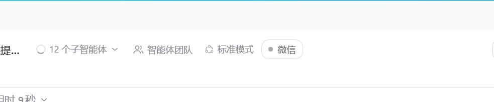
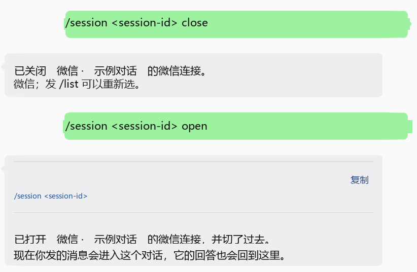
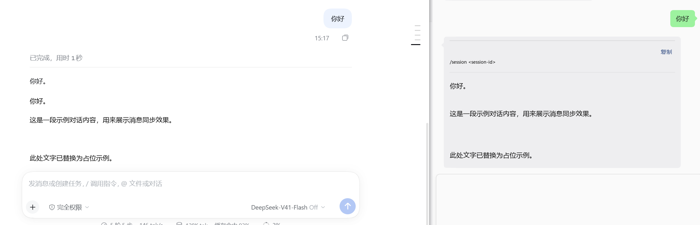
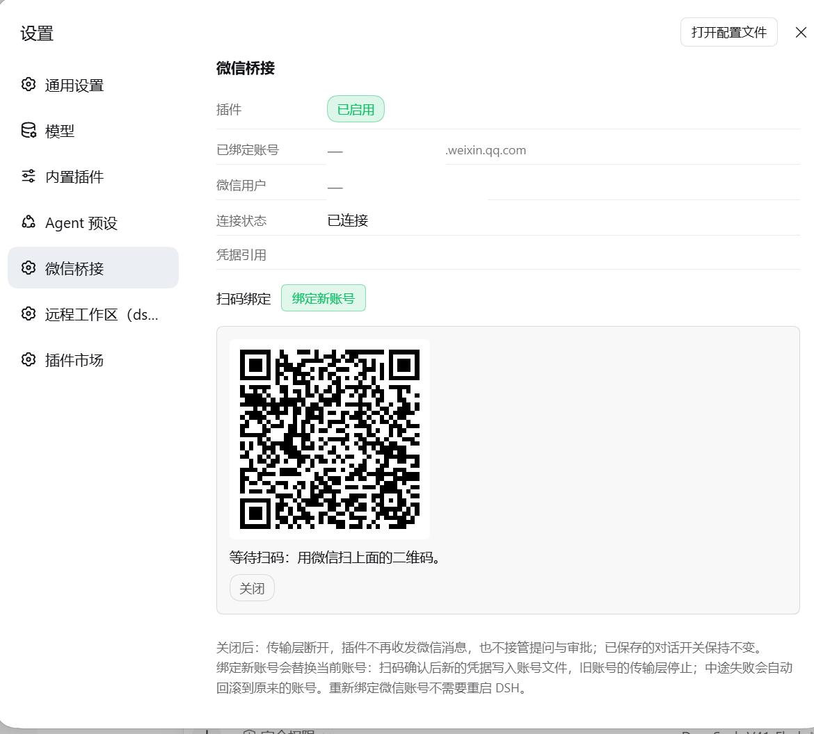

# dsh-wechat-box

DeepSeek Harness（DSH）的**微信桥接插件**：给每个对话一个开关，打开就能和微信双向对话；
在微信里发任意消息会收到一份**编号对话列表**，回一个数字就切过去。

- 微信侧协议与坑：见 [`DESIGN.md`](DESIGN.md)（设计文档，记录了真实功能与踩过的坑）
- 一句话：**把你的微信变成 DSH 会话的第二块屏**，并且提问/审批也能在微信里答。

### 截图

会话标题右侧的「微信」开关（开 = 该对话双向回传）：



微信侧一边发命令一边看回执：`/session <id> close|open`，回复里带可长按复制的 `/session <id>` 围栏块：



回合回答自动镜像回微信，左边是 DSH、右边是微信，同一条内容两块屏：



设置 → 微信桥接：账号、连接状态、扫码绑定：




---

## 目录

- [功能](#功能)
- [安装（一键）](#安装一键)
- [第一次使用：在微信里选中一个对话](#第一次使用在微信里选中一个对话)
- [微信侧命令速查表](#微信侧命令速查表)
- [配置](#配置)
- [HTTP 路由](#http-路由)
- [排障](#排障)
- [架构](#架构)
- [测试](#测试)
- [致谢与出处](#致谢与出处)
- [许可](#许可)

---

## 功能

下面每一条都在代码里有对应实现（括号里是位置）。

### 1. 每个对话一个开关（开 = 双向，关 = 不转发）

- 位置：会话标题右侧的「微信」胶囊按钮（插槽 `conversation.session.header.actions`，
  `lib/client.js`）。三种外观：`微信`（关）、`微信 已连通`（开）、`微信 未就绪`（宿主半边没起来，
  点了不会假装生效）。
- 状态按 **sessionId** 持久化，存在 `<DSH_HOME>/storages/wechat-box.json`，
  **默认关**（`router/router.mjs` 的 `createRouter`）。
- **开**：该对话的助手回合回答 → 微信；微信来的消息 → 投喂进该对话。
- **关**：微信仍可以**选中**它并单向下发一条消息进去，但它的输出**不回**微信
  （`lib/index.js` 的 `onInbound`：`if (!forwarding)`）。
- 「开关」和「指针」是两件事：**多个对话可以同时开着**（各自回合结束都往微信镜像），
  但微信来的一条消息**只进一个**对话（最近一次跟微信说过话的那个，
  见 `router.select` 的注释与 `reply({ bindTo })`）。

### 2. 微信侧发任意消息 → 编号会话列表 → 回数字选中

- 发任意非数字文本（且当前没有待答提问/审批/待定 `/new`）→ 回编号列表（`formatSessionList`）：

  ```
  选择一个对话：
  1. ● 示例对话标题（D:\work\project-a）· 运行中
  2. ○ 另一个对话（D:\work\project-b）
  3. ○ 未命名

  回复数字即可切过去（● = 当前已连通，会自动打开它的开关）。
  发 /off 停止回传，发 /list 重新列一次。
  ```

  行里带工作区路径（截断 28 字符）和 `· 运行中` 标记；● 表示已连通。
- 回数字 `N` → 选中第 N 个会话，**自动打开它的开关**，然后回确认
  （`formatSelected`），并**额外单独发一条可复制的会话 ID**。
- 数字越界 → `没有第 N 个对话，只有 1–M。发 /list 看列表。`
- 一条会话都没有 → `当前没有可选的对话。先在 DSH 里建一个会话再试。`

### 3. `/new` 在工作区新建会话并自动接通

- `/new` → 回**编号工作区列表**（最多 9 个，`MAX_WORKSPACE_CHOICES`，`formatWorkspaceList`）：

  ```
  在哪个工作区新建对话？
  1. D:\work\project-a
  2. D:\work\project-b

  回复数字即可（2 分钟内有效，发其它消息会取消）。
  ```

- 回数字 → 宿主 `sessionController.create({ workspaceId, cwd })` 新建会话 →
  **自动选中并打开开关** → 回确认（`formatNewSession`）。
- 工作区来源是宿主的 workspace registry；拿不到就退化成「最近会话的 cwd 去重」
  （`listWorkspaces`，`workspaceSource` 会在 state 路由里报出来是 `registry` 还是 `sessions`）。
- 一个工作区都没有 → `没有可用的工作区：宿主既没有注册工作区，也没有任何会话带工作区路径。先在 DSH 里打开一个文件夹，再发 /new。`
- 待定的 `/new` 选择**只在内存里、2 分钟过期**（`NEW_CHOICE_TTL_MS`），重启不留；
  回复越界会**报错并重发列表**，且窗口不延长；发其它消息 → 回 `已取消新建对话。` 然后照常处理那条消息。

### 4. `/session <id> open|close`

- `/session <id>` → 把这条微信聊天绑到那个会话**并打开它的开关**（等价于回数字选中）。
- `/session <id> open` → 同上，方向写明白（回 `formatSessionOpened`）。
- `/session <id> close` → 关掉它的开关；回 `formatSessionClosed`。
- 未知 id → `没有找到会话 <id>。发任意消息可以看到编号列表。`（不猜、不改状态）。
- `/s` 是 `/session` 的别名。

### 5. 扫码绑定新微信账号

- 位置：**设置 → 微信桥接 → 扫码绑定 → 「绑定新账号」**（`lib/client.js` 的 Settings 区块，
  插槽 `settings.section`）。
- 流程：拉二维码（`POST ilink/bot/get_bot_qrcode?bot_type=3`）→ 渲染成内联 SVG data URL 显示
  → 每 1 秒轮询一次状态 → 手机上确认 → 凭据写入 `ctx.credentials` + 账号文件 → 新 transport 起来、
  旧 transport 停掉。
- 8 个扫码状态都有中文提示（`LOGIN_STATUS_TEXT`）：`wait` / `scaned` / `confirmed` / `expired` /
  `scaned_but_redirect` / `need_verifycode` / `verify_code_blocked` / `binded_redirect`。
- `need_verifycode` 会在页面上出**配对码输入框**（校验 `/^\d{4,8}$/`）。
- `binded_redirect`（这个微信号已绑定过）：本地有凭据就**直接激活**，没有就报 `already-bound`，
  **不会假装成功**。
- **激活失败会整体回滚**到原账号（账号文件、凭据记录、旧 transport 一起还原）。
- **重新绑定不需要重启 DSH**（客户端半边靠 F5 刷新即可）。
- 二维码渲染依赖 `qrcode` 包（从 profile 的 `node_modules` 解析，与 dsh-im 用的是同一个）；
  解析不到时会退化成返回原始链接而不是静默不显示。

### 6. 提问 / 审批自动推到微信（R7）

- **提问**：宿主发起 `ask_user_question` → 推向微信（`harness/questions.mjs` 的 `questionText`）：

  ```
  DeepSeek Harness 需要你补充信息：

  <header>

  <问题正文>

  <detail>

  1. 选项 A — 说明
  2. 选项 B — 说明

  请回复一个选项序号或文字，也可直接输入其他答案。
  ```

  多选时提示改为「多选用逗号分隔」；多个问题会带 `（1/2）` 进度分批推送。
  **回数字或文字即作答**；`selected` 里存的是选项 **label**（不是序号）。
- **审批**：宿主发起审批 → 推向微信（`approvalText`）：

  ```
  DeepSeek Harness 需要你的审批：

  要执行：<工具名>

  <原因>

  回复「批准」执行一次，或回复「拒绝」。
  ```

  回复映射（`harness/approvals.mjs`）：
  **批准** = `批准/同意/允许/可以/好的/好/行/是/确认/yes/y/ok/allow/approve/1`；
  **拒绝** = `拒绝/不同意/不允许/不行/不要/否/不/no/n/deny/reject/2`。
  **看不懂就重新提问，绝不猜。**
- 三条关键语义（都有测试固化）：
  1. **待答的提问/审批优先于编号选择器**——你回的那句话首先是答案，不是新指令；
  2. 网页/CLI 的原生作答面和微信**竞速，先到者胜**，输的一方丢掉自己的 pending，
     避免你稍后回的数字去回答一个模型已经翻篇的问题；
  3. 原生作答者返回 `'unavailable'`（网页端压根没人）或**抛错**都**不算答案**，
     微信侧继续等——否则审批会变成「界面没人、微信也收不到」的静默失败。
- `/list` 可重发当前问题；空白回复会重新提问；`AbortSignal` 取消和 10 分钟超时都会释放 pending。
- **同一时刻只允许一个提问在飞**；第二个提问直接交还宿主（`next()`）。
- 这两个 waterfall 处理器**只在安全阀打开时注册**（见[配置](#配置)）。

### 7. 回合回答自动镜像回微信

- 一个回合**成功完成**（`turn/end` 且 reason 是 completed）时，把该回合的助手文本合并后推到微信
  ——**仅当该会话开关为 ON**（`onTurnComplete`）。
- 取消/中断/报错的回合**不推**（`harness/bridge.mjs` 的 `isCompletedTurn` / `turnReasonKind`）。
- 超过 1800 字符会**自动分片**（微信单条上限），在窗口内最后一个换行处切，
  但那个换行必须落在 60% 之后，否则硬切（`splitForWeChat`）；
  中途某片发送失败就停止后续分片，**不会把半个回答当成完整回答**。
- 镜像出去的消息会**把这条微信聊天重新绑到它自己的会话**，所以你直接回一句话就落回同一个对话
  ——但**不会**顺带打开一个关着的开关（push 可以移动指针，不能开开关）。

### 8. 每条消息带可复制的 `/session <id>` 围栏块

- 所有出站消息（除少数例外）都在开头带一个三反引号围栏块：

  ````
  ```
  /session <session-id>
  ```
  ````

- 微信客户端会把围栏渲染成**自带复制按钮的代码块**，长按/点击即可整条复制；
  粘回聊天框发出去，这条微信就**重新绑定到那个会话**。
  这是「我手上已经有 id」时的快路径。
- 例外：`/session <id> close`、`/off`、`/new` 系列、错误提示等**不带**这个头
  （`reply(..., { withSession: false })`），因为此时指针已经不是它了；
  单独发的那条「会话 ID」也不带——那个块必须**只装 id**，否则一次复制会连前缀一起粘出来
  （见 `replyCopyable`）。

### 9. 主动推送（可选）

`POST /api/dsh-wechat-box/push`，body `{"text":"…"}`（可带 `sessionId`、`userId`）。
走**本插件自己的 transport**，不另起第二个长轮询消费者。

### 10. 发文件

`POST /api/dsh-wechat-box/file`，body `{"path":"D:\\out\\报告.pdf"}`（可带 `sessionId`、`userId`）。

发文件不是一条消息就完事，iLink 上是三步（`transport/weixin.mjs` 的 `sendFile`）：

1. `POST ilink/bot/getuploadurl` —— 拿到 CDN 预签名地址。请求要同时带**明文**的
   `rawsize` / `rawfilemd5` 和**密文**的 `filesize` / `aeskey`，服务端靠它们分配槽位并校验。
2. `PUT` 密文到该地址（AES-128-ECB + PKCS#7，密钥每次现生成；CDN 是预签名地址，**不带** iLink 鉴权头）。
3. `POST ilink/bot/sendmessage` —— `item_list` 放 `{"type":4,"file_item":{media_id,file_name,file_size,md5}}`。

注意两套编号别混用：**上传槽位** `media_type` 1=图片 2=视频 3=文件 4=语音；
**消息 item** 的 `type` 2=图片 3=语音 4=文件 5=视频。

单文件上限 30MB（整段要读进内存再加密）。没有 `context_token` 时**直接拒绝**而不是假装成功——
那种发送会被平台接受然后静默丢弃。路径由调用方给出，插件不猜。

---

## 安装（一键）

前置：已经装好 DSH，并且**至少启动过一次**（这样 `~/.dsh/profiles/<profile>/` 才存在）。

```powershell
# 默认：装进去，但安全阀关着（不接微信）
powershell -ExecutionPolicy Bypass -File D:\path\to\dsh-wechat-box\install.ps1

# 装并且直接接管微信
powershell -ExecutionPolicy Bypass -File D:\path\to\dsh-wechat-box\install.ps1 -WeChat

# 只看计划，不写任何东西
powershell -ExecutionPolicy Bypass -File D:\path\to\dsh-wechat-box\install.ps1 -DryRun

# 卸载（移除 junction、bundles 条目、依赖，并关掉安全阀）
powershell -ExecutionPolicy Bypass -File D:\path\to\dsh-wechat-box\install.ps1 -Uninstall
```

参数：

| 参数 | 默认 | 含义 |
|---|---|---|
| `-Profile <name>` | `desktop` | 装到哪个 DSH profile |
| `-WeChat` | 关 | 打开安全阀（`weixinEnabled: true`） |
| `-DryRun` | 关 | 只打印计划，**不写任何文件** |
| `-Uninstall` | 关 | 卸载（先备份） |

脚本做的 7 件事（每一步都会打印它做了什么）：

1. 检查 profile 目录存在；
2. 在 `<profile>\node_modules\` 下创建指向本仓库的 **junction**；
3. 把 `dsh-wechat-box` 加进 profile `package.json` 的 `dsh.profile.bundles`（幂等）；
4. 把它加进 `dependencies`（`"dsh-wechat-box": "link:<本仓库绝对路径>"`）
   —— **这一步是 DSH 插件管理面板能列出它的条件**，只加 bundles 是不够的；
5. 写 `cordis.patch.yml` 的 `weixinEnabled`（默认 `false`，`-WeChat` 时 `true`）；
6. **改任何文件之前**先把要改的文件备份到 `<本仓库>\_baseline\install-<时间戳>\`；
7. 结尾打印「重启 DSH 后生效」+ 自检命令。

装完**必须重启 DSH**（宿主半边是被宿主 import 过的 ESM 模块，只有重启会重新读；
刷新网页不够）。

> `install.ps1` 是**纯 ASCII** 的。Windows PowerShell 5.1 对没有 BOM 的 `.ps1`
> 会按 ANSI 代码页解码，非 ASCII 注释会让整个脚本语法报错。
> 同理，所有写入都走 `WriteAllText(..., UTF8Encoding($false))`：
> PS 5.1 的 `Set-Content -Encoding UTF8` **会写 BOM**，而 DSH 宿主对 `package.json`
> 做逐字节 `JSON.parse`，BOM 即语法错误 → **宿主启动即死**。

### 如果你原本用 `migrate.ps1`

`migrate.ps1` 是本项目迁移时用的分阶段工具（`-Check` / `-Phase1` / `-Phase2` / `-Rollback`）。
`install.ps1` 覆盖的是同样的事情，只是幂等、可 `-DryRun`、可 `-Uninstall`。
两者不要同时对同一个 profile 跑。

---

## 第一次使用：在微信里选中一个对话

**唯一必须人工做的一步**：在微信里给机器人发一条消息 → 收到编号列表 → 回数字。

之后：

- 那个会话的开关自动打开，微信就是它的第二块屏；
- 想换会话：随便发一条消息 → 回数字；
- 想停：`/off`。

---

## 微信侧命令速查表

下表「回复文案」列**逐字抄自代码**（`router/router.mjs` 与 `lib/index.js`），
不是重新编写的说明。

| 命令 / 输入 | 行为 | 回复文案 |
|---|---|---|
| 任意非数字文本（无待答项） | 回编号会话列表 | `选择一个对话：` + 每行 `N. ●/○ 标题（cwd）· 运行中` + 空行 + `回复数字即可切过去（● = 当前已连通，会自动打开它的开关）。` + `发 /off 停止回传，发 /list 重新列一次。` |
| 数字 `N`（1–M） | 选中第 N 个会话并**打开其开关** | `已切到 N. <标题>，开关已自动打开。` / `现在你发的消息会进入这个对话，它的回答也会回到这里。` 然后**另发一条**：`会话 ID（长按下面那条即可整条复制）：` + 围栏块里的纯 id |
| 数字越界 | 报错（不改状态） | `没有第 N 个对话，只有 1–M。发 /list 看列表。` |
| 一个会话都没有时回数字 | 报错 | `当前没有可选的对话。` |
| `/list`、`/sessions`、`/ls`、`列表`、`list` | 强制重发编号列表 | 同第一行（同样带围栏块） |
| `/off`、`/stop`、`停止`、`关闭` | 断开当前选中：开关置关、指针清空 | `已断开。这个对话的回答不再发到微信；发任意消息可以重新选。` |
| `/new` | 第 1 步：回编号工作区列表 | `在哪个工作区新建对话？` + 每行 `N. <路径>` + 空行 + `回复数字即可（2 分钟内有效，发其它消息会取消）。` |
| （`/new` 之后的）数字 `N` | 第 2 步：在该工作区新建会话，并自动选中 + 开开关 | `已在 <cwd> 新建对话，并切了过去（开关已打开）。` / `标题：<标题或（新对话，还没有标题）>` / `会话 ID：<id>` / `现在你发的消息会进入这个新对话，它的回答也会回到这里。` |
| （`/new` 之后的）越界数字 | 报错**并重发列表**，窗口不延长 | `没有第 N 个工作区，只有 1–M。` + 空行 + 完整的工作区列表 |
| （`/new` 之后的）其它任何消息 | 取消待定选择，并**继续处理这条消息** | `已取消新建对话。` 然后按该消息本来的含义处理 |
| `/new` 且没有任何工作区 | 报错，不开待定选择 | `没有可用的工作区：宿主既没有注册工作区，也没有任何会话带工作区路径。先在 DSH 里打开一个文件夹，再发 /new。` |
| `/session <id>`（或 `/s <id>`） | 绑定到该会话 + 打开开关（回数字选中的等价形式） | `已切到 N. <标题>，开关已自动打开。` + … |
| `/session <id> open` | 同上，方向写明 | `已打开 <标题> 的微信连接，并切了过去。` / `现在你发的消息会进入这个对话，它的回答也会回到这里。` |
| `/session <id> close` | 关掉该会话的开关 | `已关闭 <标题> 的微信连接。` / `它的回答不再发到微信；发 /list 可以重新选。` |
| `/session <未知 id>` | 报错（不改状态） | `没有找到会话 <id>。发任意消息可以看到编号列表。` |
| 普通文本（有选中且开关**开**） | 投喂进该会话 | （静默；回答回到微信） |
| 普通文本（有选中但开关**关**） | **不转发** | `这个对话的微信开关是关着的，消息没有转发过去。` / `发 /list 重新选一个，或发 /off 断开。` |
| 普通文本（没有选中） | 回编号列表 | 同第一行 |
| 普通文本（桥接不可用） | 报错 | `会话桥接未就绪（<bridgeError 或 unknown>），暂时无法转发。` |
| 投喂失败 | 报错 | `消息没能送进会话：<错误>` / `（这条会记录在 state 路由的 bridgeError 里）` |
| 待答提问时回数字/文字 | 作为**答案**（优先于选择器） | （宿主的提问被作答，模型继续跑） |
| 待答提问时回 `/list`、`/?`、`?`、`选项` | 重发当前问题 | （重新推送问题文本） |
| 待答审批时回「批准」等 | 审批通过（`allowed-once`，执行一次） | （审批被作答） |
| 待答审批时回「拒绝」等 | 审批拒绝（`rejected`） | （审批被作答） |
| 待答审批时回看不懂的话 | **重新提问**，不猜 | （重发审批提示） |

---

## 配置

### `cordis.patch.yml` 里的 `weixinEnabled`（安全阀）

```yaml
- insert:
    - id: dsh-wechat-box
      name: 'dsh-wechat-box'
      config:
        weixinEnabled: true
```

| 值 | 含义 |
|---|---|
| `false` | **安全阀关闭**。宿主半边加载、网页开关渲染、harness 桥接会观察回合，但**微信传输层不连接**，提问/审批的 waterfall 处理器**也不注册**。 |
| `true` | **接管微信**：长轮询连上，提问/审批接管，回合镜像生效。 |

**为什么需要这个阀门**：微信机器人**同一时刻只允许一个长轮询消费者**，两个消费者会互相抢消息、
共用同一个游标，把两边都搞坏。所以：

- 如果 `@xmanrui/dsh-im` 还在同一个 profile 的 bundles 里，**必须**让 `weixinEnabled: false`；
- 要打开它，就得**在同一次重启里**把 `@xmanrui/dsh-im` 从 bundles 移除
  （`migrate.ps1 -Phase2` 就是把这两步绑在一起做的）。

### 运行时的开关可以覆盖它

设置页的开关会把结果写进 `<DSH_HOME>/storages/wechat-box.config.json`，
**它的优先级高于 bundle 配置**（bundle 配置是安装时的默认值，改它要动文件+重启；
而用户手动的选择必须能活过重启）。state 路由的 `weixinEnabledSource` 会告诉你当前值来自
`bundle-config` 还是 `settings-file`。

### 状态文件位置

`<DSH_HOME>` 默认是 `~/.dsh`（可用环境变量 `DSH_HOME` 覆盖）。
`<profile>` 默认是 `desktop`（可用环境变量 `DSH_PROFILE` 覆盖）。

| 文件 | 内容 |
|---|---|
| `<DSH_HOME>/storages/wechat-box.json` | 每个会话的开关 + 当前指针（`selectedId`）—— 本插件自己的状态 |
| `<DSH_HOME>/storages/wechat-box-account.json` | 扫码绑定的账号身份：`botId` / `accountId` / `ownerUserId` / `baseUrl`（**不含 token**） |
| `<DSH_HOME>/storages/wechat-box-transport.json` | 传输层状态：长轮询游标 `buf`、每用户 `contextTokens`、去重环、凭据指纹 `credentialHash` |
| `<DSH_HOME>/storages/wechat-box.config.json` | 设置页写的运行时开关（`weixinEnabled`） |
| `<DSH_HOME>/wechat-box-boot.log` | 启动追踪（见[排障](#排障)） |
| `<DSH_HOME>/integrations/dsh-weixin/config.json` | **旧位置**：`@xmanrui/dsh-im` 绑定的账号，只读兼容，本插件不写它 |

token 本身**不落上面任何一个文件**：它写在 DSH 的凭据仓库里（`ctx.credentials`），
键名形如 `dsh-wechat-box/<botId>`。这是这个插件**唯一**被设计为持有密钥的地方。
state 路由里所有真实标识符都做过掩码（`1e72c8….bot`）。

### 每个 provider 的传输层设置

`transport/weixin.mjs` 有一份 `DEFAULTS`（长轮询超时、退避节奏、去重环上限
`seenLimit`、`contextTokenLimit`、连续失败上限、`botAgent` 等），
可用 `createWeixinTransport({...})` 的选项覆盖，也可通过环境变量给凭据。

---

## HTTP 路由

全部由宿主半边注册（`lib/index.js`）。**未鉴权**（跑在本机回环上），
所以除了 `/push` 之外都只读或只写开关，且不返回任何密钥。

| 方法 | 路径 | 作用 |
|---|---|---|
| `GET` | `/api/dsh-wechat-box/state` | 插件自述状态：开关、`weixinEnabled`、`transportReady`、`applyError`、`bridgeError`、`bridgeServices`（含 `canSubmit`）、`questionsRegistered`、`approvalsRegistered`、`newSession`、掩码后的 `account`、`login`、`transport.status()` |
| `POST` | `/api/dsh-wechat-box/toggle` | 开关读写，body `{"sessionId","enabled","title?"}` |
| `POST`/`GET` | `/api/dsh-wechat-box/beacon` | 客户端半边的三级信标（`eval` / `factory` / `registered` / `error`） |
| `POST` | `/api/dsh-wechat-box/enabled` | 运行时开关，body `{"enabled":true|false}`，会持久化 |
| `POST` | `/api/dsh-wechat-box/push` | 主动推一条，body `{"text":"…"}`（可选 `sessionId` / `userId`） |
| `POST` | `/api/dsh-wechat-box/file` | 发一个磁盘上的文件，body `{"path":"…"}`（可选 `sessionId` / `userId`） |
| `POST` | `/api/dsh-wechat-box/login/begin` | 拉二维码，返回 `qrImage`（内联 SVG data URL）与 `expiresAtMs` |
| `POST` | `/api/dsh-wechat-box/login/poll` | 轮询扫码状态，可带 `verifyCode` |

---

## 排障

### 一条命令自检

```powershell
& 'D:\path\to\dsh-wechat-box\verify.ps1'
```

只读：不往微信发任何消息、不改任何文件。可选 `-Port 19387`。
它分 5 节给结论：宿主进程 → 启动追踪 → 宿主半边路由 → 客户端半边三级信标 →
宿主是否公告了客户端 bundle，最后直接给判读。

> 注意 `verify.ps1` 的部分提示文案还是「阶段 1」时代的（它会把
> `weixinEnabled = True` 标成「阶段 1 应为 False」）。**以它打印的实际值为准**，
> 不要被那行括号里的期望值误导。

### `~/.dsh/wechat-box-boot.log` 是什么

宿主半边的**文件级启动追踪**，由 `lib/index.js` 的 `bootTrace()` 在每一步 append 一行：

```
2026-10-14T07:02:50.489Z pid=20268 module-evaluated :: apply=function inject=["webServer"]
2026-10-14T07:02:51.003Z pid=20268 inject-webServer-resolved :: sameAsPluginLevel=false
2026-10-14T07:02:51.004Z pid=20268 route-registered :: /api/dsh-wechat-box/state -> function
2026-10-14T07:02:51.483Z pid=20268 interactions-enabled
2026-10-14T07:02:51.484Z pid=20268 apply-ok
```

**为什么要靠文件**：插件的诊断通道就是它自己的 HTTP 路由——而插件失败时，
恰好就是这些路由不存在的时候。于是「宿主公告了客户端半边、但每个请求都 401」
这种失败从外面完全看不见。所以另开一条**不依赖被诊断对象**的通道。

按 `pid=` 过滤只看当前这次启动（测试脚本也会往同一个文件追加）。
关键节点：`module-imported` → `module-evaluated` → `apply-enter` → `routes-registered` →
`account-loaded` → `credential-loaded` → `interactions-enabled` → `apply-ok`。

### 常见症状 → 原因

| 症状 | 原因 | 怎么办 |
|---|---|---|
| `GET /api/dsh-wechat-box/state` → **401** | **宿主半边没注册路由**。这不是页面问题。典型原因：`apply()` 抛错（例如它返回了普通对象，Cordis 会 `throw TypeError('Invalid effect')` 并**销毁整个 fiber**，刚注册的路由连带被注销），或者 bundle 被 `skippedBundles` 丢掉。 | 看 `wechat-box-boot.log` 里本次 pid 的最后几行：有 `apply-threw` 就是它自己说了原因；只有 `module-imported` 说明模块根本没被加载（查 bundles / `dsh.bundle.patch`）。 |
| 200 但 `applyError` 非空 | 插件装配失败，但它**自己说出了原因** | 直接照 `applyError` 修 |
| `beacon` 为空 | 页面里客户端 bundle 没被执行 | 看「设置 → 插件 → 插件列表」的「当前页面的同步失败」 |
| `beacon` 只有 `error` | 槽位注册被拒 | `detail` 就是原因 |
| `beacon` 有 `eval` + `factory` 但没有 `registered` | 插件物化了但注册没完成 | 见 `error` 条目 |
| 会话标题右侧**没有**「微信」胶囊，但 beacon 有 `registered` | 组件对空 sessionId 返回 null | 确认当前确实打开了一个会话 |
| 按钮显示 **`微信 未就绪`** | 宿主半边路由没起来（同第一个 401） | 点击是**故意无效**的：一个按下去就弹回来的开关读起来像「坏了」，而真正要传达的是「宿主还没加载这条路由」。重启 DSH。 |
| `transportError` = `transport disabled by config (weixinEnabled=false)` | **安全阀生效**，微信没被打扰 | 符合预期；要接管微信就 `-WeChat` 或改 patch 后重启 |
| 微信里**消息静默丢失** | 历史坑：微信来的消息到了传输层、也回调了 `onInbound`，但 `!forwarding` 分支之外**投喂失败只写了日志**，于是用户在微信前干等。现在**任何失败路径都会回一条微信**，并把原因记进 state 路由的 `bridgeError`。 | 看微信里有没有收到错误文案；再看 `bridgeError` / `bridgeServices.canSubmit` |
| `bridgeServices.canSubmit = false` | 宿主服务没到手（`sessionController.prompt` 和 `typertGateway.invoke` 都不可用），**投递必然失败** | 此时 `listSessions` 走退路仍然能用（只有 `ctx.sessions` 时从 `session/title` 事件读标题），所以桥接**看起来是健康的**——这正是要把它报出来的原因 |
| 发消息被拒，结果里 `code: 'send-rejected'`，`providerCode: '-2'` | **`context_token` 陈旧**。出站消息要带该用户的 `context_token`，它**只从入站消息里拿得到**，且整体绑定在 bot 凭据上（`credentialHash = sha256(token)`，换 token 即全部作废）。很久没收到对方消息、或换过 token，手里那个就可能已经失效。 | 让对方（或你）**在微信里先发一条消息**刷新 `context_token`，再重试。传输层状态里的 `contextTokenCount` 可以确认表里有没有这一条。**备注**：`-2` 这个具体数值来自真机观察，**仓库里没有任何地方硬编码它**；`send-rejected` 的判定是「`ret`/`errcode` 首个非零值」（`rejectedProviderCode`），所以任何非零 `providerCode` 都应先怀疑 `context_token` / 凭据。 |
| 长轮询停了，`lastError` 提到 `ret=-14` 或 `code: 'stale-token'` | 平台**明确判死**：这个 bot token 失效了。传输层只在 `ret/errcode = -14` 时才终止循环（其它错误一律退避重试）。 | 重新扫码绑定（设置 → 微信桥接 → 绑定新账号） |
| **发送报告成功、对方却收不到**；或结果里 `code: 'no-context-token'` | **没有 `context_token` 的发送是「假成功」**：平台受理（`ok:true`）然后把消息丢掉。真机对照过 —— `contextTokenUsed:false` → 没收到；`contextTokenUsed:true` → 收到。**换绑账号后必然如此**：令牌按 bot 凭据签发（`credentialHash = sha256(token)`），换 token 即全部作废；机器人也无法主动发起会话。 | 让对方**在微信里先发一条消息**（任意内容），`contextTokenCount` 变成 `1` 之后一切正常。传输层现在会**直接拒绝**这种发送并说明原因，不再报一个不会送达的成功 —— 所以看到 `no-context-token` 就等于看到「先发一条」。**普通重启不需要**：令牌存在状态文件里会带过来。 |
| `getupdates` 被拒但还在跑 | 平台级拒绝（`providerCode`）不是致命的那些 → 记 warning + 退避重试，循环不死 | 看 `lastError` 里的 `providerCode` |
| 重启后要重新扫码/重新选会话 | 正常情况**不需要**：账号身份在 `wechat-box-account.json`、token 在凭据仓库、开关在 `wechat-box.json`、游标在 `wechat-box-transport.json`。要重新扫码通常意味着凭据记录**没了**（`lastAccountError` 会说明）——插件**拒绝**用一个空 token 起传输层，而不是假装在跑。 | 看 state 路由的 `login.accountError` |
| 二维码位置显示裂图 | 历史坑：`qrcode_img_content` **不是图片**，它是要编码进二维码的内容（一个 `https://liteapp.weixin.qq.com/...` 落地页）。直接塞给 `` 永远渲染不出来（fetch 它返回 `text/html`）。 | 正确做法（已实现）：在能解析 `qrcode` 包的地方渲染成 SVG data URL 再给浏览器。若仍是裂图，检查 `qrcode` 是否可解析。 |
| `transient` 报 `AbortError` 但 `.code` 是 20 | 历史坑：取消抛的是 DOMException，`name === 'AbortError'` 而 `.code` 是**数字 20** | 判错不能只看 `.code`，要看 `name` |
| 改完 `lib/client.js` 页面没变化 | 宿主在启动时**快照**客户端 bundle；只有 `pnpm run dev:web` 在跑时才有 HMR | 按 F5 刷新页面；宿主半边（`lib/index.js`）改动则**必须重启 DSH** |
| 改完 `weixin.mjs` 的请求头，扫码却用了旧头 | 历史坑：`transport/login.mjs` 里 `buildHeaders` / `normalizeBaseUrl` 是从 `weixin.mjs` **逐行照抄**的私有函数副本 | **改 `weixin.mjs` 的请求头时必须同步改 `login.mjs`** |
| junction 被 pnpm 当垃圾清掉了 | 历史坑：junction 没有对应的 `dependencies` manifest 条目时，下一次任何 pnpm / 插件市场操作可能把它清理掉（`install.ps1` 的第 4 步就是为了这个） | 重跑 `install.ps1` |
| DSH 启动崩溃，日志里 `Unexpected token '\uFEFF'` | `package.json` 被写进了 **BOM**（PS 5.1 的 `Set-Content -Encoding UTF8` 会写 BOM，而宿主做逐字节 `JSON.parse`） | 重写成 UTF-8 无 BOM；`install.ps1` / `migrate.ps1` 都用 `Write-Utf8NoBom` |

### 探针

- `transport/live-probe.mjs`：直接对真网探发送路径（`--send`），**会真的发一条微信**。
  它用当前状态文件里的凭据与 `context_token`，返回 `{ok, contextTokenUsed}`。
  注意它是**独立进程**，不要和宿主同时跑（两个消费者抢同一个 bot）。
- 宿主是否公告了客户端 bundle（**无需鉴权**）：
  `GET /plugins/??dsh-wechat-box/client.js&rev=<rev>` → 200 = 已公告。
  注意**不要**去请求 `/plugins/dsh-wechat-box/client.js`（那个形式对谁都 404）。

---

## 架构

```
┌─────────────────────── DSH Host 进程 ───────────────────────┐
│                                                              │
│  dsh-wechat-box                                               │
│   ├─ transport/   微信 iLink 长轮询 + 发消息 + 登录态          │
│   ├─ router/      开关状态 + 编号选择器 + 出站分片             │
│   ├─ harness/     驱动/观察 DSH 会话（桥接 + 提问 + 审批）     │
│   └─ lib/         宿主半边（Cordis 插件 + HTTP 路由）          │
│                   客户端半边（会话开关 + 设置页）              │
└──────────────────────────────────────────────────────────────┘
              ▲                                    ▲
              │ 长轮询                              │ 同源 fetch
              ▼                                    │
   https://ilinkai.weixin.qq.com/           DSH Web 客户端
        （微信机器人）                        （会话标题右侧开关）
```

| 模块 | 文件 | 职责 |
|---|---|---|
| **transport** | `transport/weixin.mjs` | 微信 iLink 协议：`getupdates` 长轮询、`sendmessage` 发消息、游标与去重环持久化、`context_token` 生命周期、错误分类（`classifyError`）、指数退避。<br>`transport/login.mjs` 是扫码登录原语（拉码 + 8 状态轮询）。<br>`transport/live-probe.mjs` 是联网探针。 |
| **router** | `router/router.mjs` | 纯逻辑、只读写一个 JSON 文件：开关状态（R1–R4）、入站文本分类（`classifyInbound`）、编号列表/确认/越界文案、`/new` 的工作区选择（`createPendingChoice`，带 TTL）、出站分片（`splitForWeChat`，1800 字符）。 |
| **harness** | `harness/bridge.mjs` | 把「宿主里的某个会话」当成可寻址远端对象：`listSessions` / `submitUserText` / `isSessionRunning` / `dispose`，并在回合**成功完成**时回调 `onTurnComplete`。正路是 `sessionController.prompt`，退路是 typert 网关的 `session/prompt`。<br>`harness/questions.mjs` 提问 waterfall；`harness/approvals.mjs` 审批 waterfall。 |
| **lib** | `lib/index.js` | 宿主半边：Cordis 插件本体。**先注册 HTTP 路由，再做任何可能失败的 await**；把 transport / router / bridge / 两个 waterfall 串成一个插件；扫码激活与回滚；设置页驱动的运行时开关。<br>`lib/client.js` 客户端半边：会话标题右侧的开关 + 设置页的「微信桥接」区块（含扫码流程）。 |

### 设计上的几条硬规则（踩过坑才有的）

1. **`apply()` 绝对不能有返回值**（除非是函数 / disposer 数组）。
   Cordis 把插件 `apply` 的返回值当 effect 结果处理，只接受函数、`null`/`undefined`、
   thenable、可迭代的 disposer。**返回普通对象会 `throw TypeError('Invalid effect')`**，
   该异常让 fiber 启动失败并**销毁整个 fiber**——刚注册的路由会在 1 毫秒后被连带注销，
   于是**宿主半边全部 401，而插件内部看起来一切正常**。同一条规则适用于
   `ctx.inject(deps, cb)` 的回调（它就是插件体）。
2. **插件必须声明 `export const inject = [...]`**，否则实测宿主只 import 模块、不调用 `apply`。
3. **要注册 HTTP 路由必须用 `ctx.inject(['webServer'], cb)` 拿到的那个对象**：
   插件级 `inject: ['webServer']` 拿到的对象与它**不是同一个**
   （实测 `same === false`），用前者注册会「成功返回 disposer」但请求全部 401。
4. **Cordis 里读未声明的服务会抛错**，不是返回 `undefined`
   （`cannot get property "X" without inject`）。要探测式读取必须 try/catch 包住
   （见 `serviceFrom`）。
5. **路由注册必须排在最前面**：`apply` 一旦在注册路由之前抛错，插件就失去了自我解释的能力。

---

## 测试

11 个套件、**194 项断言**，全部用 node 内置的 `node:test` 风格自研断言，零测试框架依赖：

```powershell
# 用绝对路径的 node（本机 PATH 是坏的）
& '<node 绝对路径>' 'D:\path\to\dsh-wechat-box\lib\test-manifest.mjs'
```

或者一次跑完（`package.json` 的 `scripts.test` 覆盖了其中 10 个，`transport/test-login.mjs`
需要单独跑）：

| 套件 | 项数 | 覆盖 |
|---|---|---|
| `lib/test-manifest.mjs` | 6 | 包清单与宿主加载契约（`main`/`exports`/`dsh.bundle.patch`/`dsh.client`） |
| `router/test.mjs` | 20 | 开关状态、分类器、编号列表文案、`/new` 待定选择、分片 |
| `transport/test.mjs` | 17 | 长轮询、去重、发送、退避、`context_token`、错误分类 |
| `transport/test-login.mjs` | 24 | 扫码协议：URL/头/请求体、8 状态、脏响应、超时与取消 |
| `harness/test.mjs` | 14 | 回合文本合并、终态判定、会话枚举、投喂、退路 |
| `harness/test-questions.mjs` | 15 | 提问往返、`/list` 重发、竞速、取消、超时 |
| `harness/test-approvals.mjs` | 12 | 审批往返、不肯猜、原生 `unavailable`/抛错不丢审批 |
| `lib/test.mjs` | 55 | 宿主半边：R1–R5、`/new`、`/session`、路由、安全阀、扫码激活与回滚 |
| `lib/test-client.mjs` | 10 | 客户端 bundle：加载握手、槽位注册、开关渲染与点击、信标 |
| `lib/test-integration.mjs` | 13 | 真桥接 + 真宿主壳 |
| `lib/test-e2e.mjs` | 8 | 真 transport 模块对着桩服务器端到端 |

**任何测试都不许打到 `ilinkai.weixin.qq.com`**：`config.modules` / `config.login` 是测试缝，
把 transport / bridge / login 换成桩。

---

## 致谢与出处

- **微信 iLink 传输层移植自 [`@xmanrui/dsh-im`](https://github.com/xmanrui/dsh-im)（MIT）**。
  `transport/weixin.mjs` 的状态模型、长轮询循环、`context_token` 生命周期、
  错误分类与退避节奏，以及 `transport/login.mjs` 的扫码协议细节，都来自该项目的
  `src/channels/weixin/weixin-api.mjs`、`weixin-bridge.mjs`、`weixin-controller.mjs`、
  `weixin-runtime.mjs`、`state-store.mjs`、`config-store.mjs`、`connection-error.mjs`；
  源码注释里保留了逐条的「本文件 ← 原文件:行号」对照表。
  > 仓库链接占位：`https://github.com/xmanrui/dsh-im`（若上游地址有变，请以 npm 包
  > `@xmanrui/dsh-im` 的 `repository` 字段为准）
- `harness/questions.mjs` 的问题渲染与「文字 → 答案」解析移植自同一项目的
  `src/channels/shared/harness-question.mjs`（MIT），去掉了 i18n 间接层。
- `harness/bridge.mjs` 的行为契约与若干函数改写自同一项目的
  `harness-client.mjs` / `deferred-delivery.mjs` / `modern-harness-api.mjs` / `session-title-prefix.mjs`（MIT）。
- 二维码渲染使用 `qrcode`（MIT），从 DSH profile 的 `node_modules` 解析。
- MIT 允许照抄与再发布；在源码里保留出处即为履行条款。

---

## 许可

[MIT](LICENSE) © 2026 dsh-wechat-box contributors
